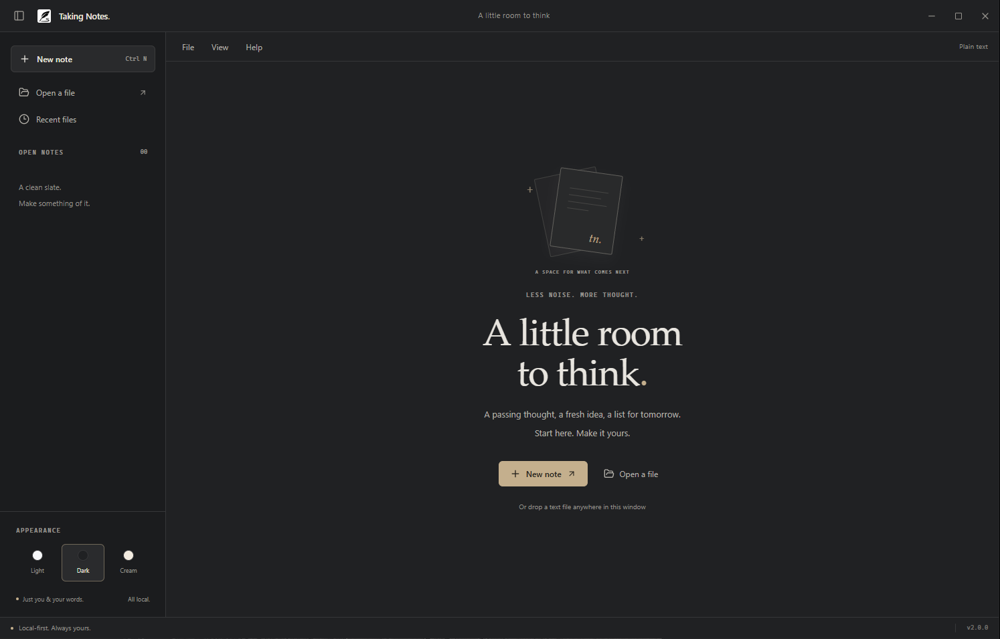

# Taking Notes


A desktop note-taking app built with Tauri and React. Designed to bring modern editing features to a lightweight, fast, and always-available experience.



## Features

- Full CRUD support for plain-text notes.
- A collapsible sidebar for working with multiple open notes.
- Local recovery snapshots while editing and on close, with session restoration on launch.
- Native file drag and drop and file opening from launch arguments or shell associations.
- Light, Dark, and Cream themes, with locally saved appearance and text-size preferences.
- Searchable recent files, word and character counts, and keyboard shortcuts.
- Motion animations that respect reduced-motion preferences.
- Offline startup and editing, without accounts or required network requests.
- Optional update checks via GitHub Releases from the Help menu.
- Responsive layout optimized for different screen sizes.

## Inspiration

The Windows 10 Notepad works, but it lacks features that Windows 11 introduced, like multi-tab support, multiple windows, and session recovery for unsaved files. Taking Notes was built to bring those features to a lightweight desktop app, while also serving as my first project with Tauri.

## Releases

Taking Notes uses the [Tauri Updater plugin](https://tauri.app/plugin/updater/) with GitHub Releases. Choose **Help → Check for updates…** to check for a new version. This optional action uses the internet; startup, note editing, and recovery do not. Available updates are installed only after confirmation, with the local session saved before restarting.

## Keyboard shortcuts

| Action | Shortcut |
| --- | --- |
| New note | `Ctrl+N` or `Ctrl+T` |
| Open file | `Ctrl+O` |
| Save file | `Ctrl+S` |
| Close note | `Ctrl+W` |
| Toggle sidebar | `Ctrl+B` |
| Increase / decrease text size | `Ctrl++` / `Ctrl+-` |
| Reset text size | `Ctrl+0` |

## Development checks

```sh
npm test
npm run build
```

From `src-tauri`, run `cargo test --locked --lib` for backend regression tests. Native launch, recovery, and file-handling details are documented in [BACKEND.md](src-tauri/BACKEND.md).
